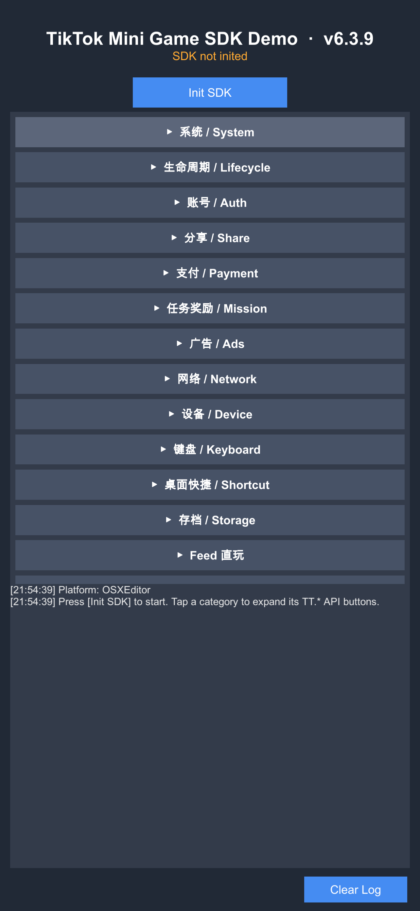
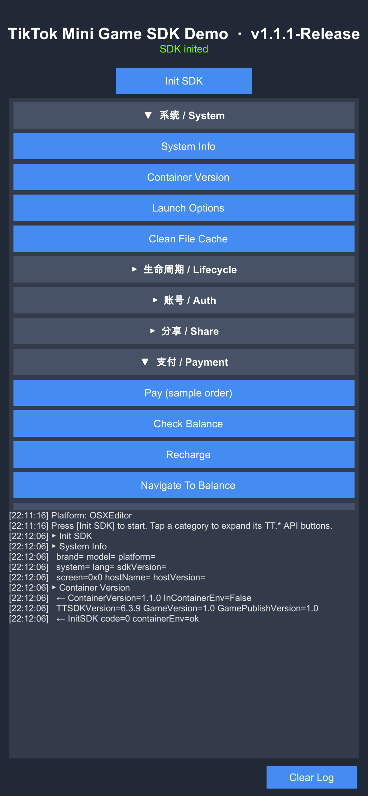

# TikTok Mini Game · Unity SDK Demo

**English** · [中文](README.zh.md)

> ## 📦 Get the SDK
>
> **[⬇️ Download `com.tiktok.minigame@1.1.7-Beta.unitypackage`](./com.tiktok.minigame@1.1.7-Beta.unitypackage)** (1.4 MB)
>
> The complete TikTok Mini Game SDK is shipped in this repo as a single Unity package.
> Drag-and-drop it into any Unity 2022.3 project, or follow
> [Integrating the SDK](#integrating-the-sdk-in-your-own-project) for the full step-by-step.

A reference Unity project that integrates the **TikTok Mini Game SDK (TTSDK v1.1.7-Beta)** and exposes
every public `TT.*` API through clickable buttons grouped by category. The log panel mirrors
every callback so you can see exactly what each API returns, both inside Unity Editor and
inside the real TikTok / Douyin mini-game container.

| Collapsed home | After Init SDK + a few calls |
| --- | --- |
|  |  |

---

## What's in this repo

| Path | Purpose |
| --- | --- |
| `com.tiktok.minigame@1.1.7-Beta.unitypackage` | Ready-to-import SDK package (TTSDK v1.1.7-Beta). Drag-and-drop into any Unity 2022.3 project. |
| `Assets/Plugins/com.tiktok.minigame/` | The SDK already imported into this project. |
| `Assets/Demo/Scripts/DemoMainMenu.cs` | Runtime menu — accordion-style category list, one button per `TT.*` API, log panel. |
| `Assets/Demo/Editor/DemoSceneBuilder.cs` | Rebuilds `MainMenu.unity` from code (menu: **TikTok Demo → Rebuild MainMenu Scene**). |
| `Assets/Demo/Editor/DemoSetup.cs` | One-click PlayerSettings + scene + WebGL switch (menu: **TikTok Demo → Run Full Setup**). |
| `Assets/Demo/Scenes/MainMenu.unity` | Entry scene (also registered as scene 0 in Build Settings). |

---

## Requirements

- Unity **2022.3.62f3** (any 2022.3.x LTS should work). Do **not** use the Tuanjie / 团结引擎
  fork — the SDK's `asmdef` will collide.
- TTSDK **1.1.7-Beta** (or ≥ 1.1.1). Since v1.1.1, the package ships a separate `ttsdk-editor.dll`
  so the Mock implementation runs inside Unity Editor without throwing.
- Build target: WebGL (IL2CPP). Other platforms are not supported by the container.

---

## Quick start

```bash
git clone https://github.com/AnranS/tiktok-minigame-unity-demo.git
cd tiktok-minigame-unity-demo
# Open the folder via Unity Hub → Add project → 2022.3.62f3 (or any 2022.3 LTS)
```

Inside Unity:

1. Wait for the initial asset import to finish.
2. Open `Assets/Demo/Scenes/MainMenu.unity` (or just press Play — it's the default scene).
3. Press **Init SDK**. Status flips to a green `SDK inited`.
4. Tap any category header (▶) to expand it, then tap a sub-button to hit the matching
   `TT.*` API. Results stream into the log panel at the bottom.

If anything looks off, you can rebuild the scene at any time via
**menu: TikTok Demo → Rebuild MainMenu Scene**.

---

## Integrating the SDK in your own project

You can grab the SDK package directly from this repo:

```
./com.tiktok.minigame@1.1.7-Beta.unitypackage
```

In your project:

1. **Drag-and-drop** the `.unitypackage` into the Unity Editor Project window, or use
   **Assets → Import Package → Custom Package…** and select the file.
2. Accept all items in the import dialog.
3. After import you should have:
   ```
   Assets/Plugins/com.tiktok.minigame/
     TTSDK/ttsdk.dll          ← runtime (WebGL only)
     TTSDK/ttsdk-editor.dll   ← editor mock (Editor only)
     Editor/ttsdk_tools.dll   ← build tool
     WebGL/                   ← platform glue
     LitJson/, DefaultTemplate/, link.xml, package.json
   ```
4. Configure **Player Settings**:
   - Build target: **WebGL**
   - Scripting backend: **IL2CPP** (Mono is not supported)
   - Company / product name as you wish — they're surfaced in the container UI
5. Confirm the WebGL platform-specific dll filters in PluginImporter (Unity should do this
   automatically from `.meta`): `ttsdk.dll` ticked only for WebGL, `ttsdk-editor.dll` ticked
   only for Editor.

That's it — `using TTSDK;` becomes available.

---

## Initializing the SDK

Initialization is a single async call. Every container-dependent API (Login / Pay / Ads /
Share / …) requires this to succeed first.

```csharp
using TTSDK;
using UnityEngine;

public class Boot : MonoBehaviour
{
    void Start()
    {
        TT.InitSDK((code, env) =>
        {
            if (code == 0)
            {
                Debug.Log($"[TT] InitSDK ok, containerEnv={env?.GetType().Name}");
                // Safe to call TT.Login / TT.Pay / TT.CreateRewardedVideoAd / …
            }
            else
            {
                Debug.LogError($"[TT] InitSDK failed, code={code}");
            }
        });
    }
}
```

In this demo the same flow lives in
[`DemoMainMenu.InitSdk()`](Assets/Demo/Scripts/DemoMainMenu.cs).

### Editor vs WebGL

| Environment | What runs | Notes |
| --- | --- | --- |
| Unity Editor (Play mode) | `TTAPIMock` via `ttsdk-editor.dll` | Mock returns reasonable defaults so you can iterate on the UI / wiring without rebuilding WebGL every time. Use the **模拟 / Mock (Editor)** category to toggle interactive mock popups per module. |
| WebGL build inside TikTok / Douyin Developer Tools or production | `TTAPIImpl` via `ttsdk.dll` | Talks to the real container; logins / payments / ads behave for real. |

You **must** use SDK ≥ 1.1.1 for Editor mock to work — earlier versions only shipped the
WebGL-target dll and would throw `NotSupportedException: 不支持的平台` in Editor.

---

## API reference

The demo covers every public `TT.*` API in **v1.1.7-Beta** across 16 runtime categories
(plus an Editor-only Mock switch category). Buttons are grouped under collapsible category
headers; each row below corresponds to buttons in `MainMenu.unity`.

### 系统 / System

| Button | API | Purpose |
| --- | --- | --- |
| System Info | `TT.GetSystemInfo()` | Host, device, locale, screen, SDK / host version. |
| Container Version | `TT.GetContainerVersion()`, `TT.InContainerEnv`, `TT.TTSDKVersion`, `TT.GameVersion`, `TT.GamePublishVersion` | Version constants for compat checks. |
| Launch Options | `TT.GetLaunchOptionsSync()` | Scene / path / query the container passed on launch. |
| Clean File Cache | `TT.CleanAllFileCache(cb)` | Wipe the SDK-managed cache directory. |

### 生命周期 / Lifecycle

| Button | API | Purpose |
| --- | --- | --- |
| Get App Lifecycle | `TT.GetAppLifeCycle()` | Fetch the singleton app lifecycle manager. |
| Register App Show/Hide | `TT.GetAppLifeCycle().OnShow / OnHide` | Foreground / background events. |
| Set Before-Exit Listener | `TT.SetOnBeforeExitAppListener(...)` | Intercept the user's exit gesture (guarded by `CanIUse.SetOnBeforeExitAppListener`). Return `true` to handle exit yourself, `false` for default exit. |

### 账号 / Auth

| Button | API | Purpose |
| --- | --- | --- |
| Login | `TT.Login(onSuccess, onFail)` | Exchange container session for a short-lived `code` your backend uses to fetch openid. |
| Authorize (user.info.basic) | `TT.Authorize("user.info.basic", onOk, onFail)` | Prompt the user to grant an authorization scope. |
| Request Subscribe Message (default / manual) | `TT.RequestSubscribeMessage(TTRequestSubscribeMessageParam)` | Ask the player to confirm message subscriptions (`isManualSubscribe = false / true`). Returns `isSubscribeConfirmed` (`accept` / `reject`). |

### 分享 / Share

| Button | API | Purpose |
| --- | --- | --- |
| Share App Message | `TT.ShareAppMessage(ShareAppMessageParam)` | Open the container share sheet. `Path` / `Query` deep-link back into the game. |

### 支付 / Payment

| Button | API | Purpose |
| --- | --- | --- |
| Pay | `TT.Pay(TTPayParam)` | Pay for a `trade_order_id` issued by your backend. |
| Check Balance | `TT.CheckBalance(TTCheckBalanceParam)` | Check whether the user has enough virtual currency (e.g. `BEANS`). |
| Recharge | `TT.Recharge(TTRechargeParam)` | Open the recharge flow for a tier id. |
| Navigate To Balance | `TT.NavigateToBalance(TTNavigateToBalanceParam)` | Jump to the user's wallet page. |

### 任务奖励 / Mission

| Button | API | Purpose |
| --- | --- | --- |
| Start Entrance Mission | `TT.StartEntranceMission(TTStartEntranceMissionParam)` | Kick off an entry-channel mission. |
| Get Entrance Mission Reward | `TT.GetEntranceMissionReward(TTGetEntranceMissionRewardParam)` | Query / claim the entrance mission reward. |
| Get Revisit Mission Reward | `TT.GetRevisitMissionReward(TTGetRevisitMissionRewardParam)` | Query revisit mission eligibility (`canReceiveReward`, `rewardScene`, `scene`). Requires host ≥ 46.0.0. |
| Report Mission Reward Granted | `TT.ReportMissionRewardGranted(TTReportMissionRewardGrantedParam)` | Notify TikTok after your game/backend grants the revisit reward so the host shows confirmation UI. Requires host ≥ 46.0.0. |

### 广告 / Ads

| Button | API | Purpose |
| --- | --- | --- |
| Rewarded Ad: Create & Load / Show / Destroy | `TT.CreateRewardedVideoAd(...)`, `Load()`, `IsLoaded()`, `OnLoad`, `Show()`, `OnClose(isEnded)`, `OnError`, `Destroy()` | Create, preload (`Load()`, host ≥ 46.1.0), check readiness (`IsLoaded()`), display, and dispose a rewarded video ad. |
| Interstitial Ad: Create & Load / Show / Destroy | `TT.CreateInterstitialAd(...)`, `Load()`, `IsLoaded()`, `OnLoad`, `Show()`, `OnClose`, `OnError`, `Destroy()` | Create, preload (`Load()`, host ≥ 46.1.0), display, and dispose an interstitial ad. |

### 网络 / Network

| Button | API | Purpose |
| --- | --- | --- |
| Get Network Type | `TT.GetNetWorkType(GetNetworkTypeParam)` | One-shot connectivity query. |
| On / Off NetworkStatus Change | `TT.OnNetworkStatusChange(cb)` / `TT.OffNetworkStatusChange(cb)` | Connection on/off subscription. |
| On / Off NetworkWeak Change | `TT.OnNetworkWeakChange(cb)` / `TT.OffNetworkWeakChange(cb)` | Weak-network toggle (lag detection). |

### 设备 / Device

| Button | API | Purpose |
| --- | --- | --- |
| Vibrate Short | `TT.VibrateShort(VibrateShortParam)` | ~15 ms (iOS) / ~30 ms (Android) haptic. |
| Vibrate Long | `TT.VibrateLong(VibrateLongParam)` | ~400 ms haptic. |
| Set FPS 30 / 60 | `TT.SetPreferredFramesPerSecond(fps)` | Hint the engine + container. |

### 键盘 / Keyboard

| Button | API | Purpose |
| --- | --- | --- |
| Show Keyboard | `TT.ShowKeyboard(...)`, `TT.OnKeyboardInput`, `TT.OnKeyboardConfirm`, `TT.OnKeyboardComplete` | Bring up the soft keyboard (WebGL only) and subscribe to input / confirm / complete events. |
| Hide Keyboard | `TT.HideKeyboard(onOk, onErr)` | Dismiss the soft keyboard. |

### 桌面快捷 / Shortcut

| Button | API | Purpose |
| --- | --- | --- |
| Add Shortcut | `TT.AddShortcut(cb)` | Prompt the user to add the game to the home screen. |
| Get Shortcut Mission Reward | `TT.GetShortcutMissionReward(GetShortcutMissionRewardParam)` | Query shortcut mission reward eligibility (`CanReceiveReward`). |

### 存档 / Storage

| Button | API | Purpose |
| --- | --- | --- |
| PlayerPrefs ++counter | `TT.PlayerPrefs.GetInt/SetInt/Save()` | Cross-platform KV store, same surface as Unity's `PlayerPrefs`. |
| Save / Load / Delete `<DemoSaving>` | `TT.Save<T>(obj)`, `TT.LoadSaving<T>()`, `TT.DeleteSaving<T>()` | Typed object persistence — one slot per type unless you pass `saveName`. |
| Clear All Savings | `TT.ClearAllSavings()` | Wipe every slot. |
| Saving Disk Size | `TT.GetSavingDiskSize()` | Bytes used by savings on disk. |

### 文件系统 / FileSystem

| Button | API | Purpose |
| --- | --- | --- |
| FS Roundtrip | `TT.GetFileSystemManager()` (`AccessSync`, `MkdirSync`, `WriteFileSync`, `ReadFileSync`, `UnlinkSync`) | End-to-end synchronous file read/write/delete test under `TTFileSystemManager.USER_DATA_PATH`. |

### Feed 直玩 / Feed

| Button | API | Purpose |
| --- | --- | --- |
| On / Off Feed Status Change | `TT.OnFeedStatusChange(cb)` / `TT.OffFeedStatusChange(cb)` | Feed-entry / feed-exit notifications for instant play. |
| Get Feed Manager | `TT.GetFeedManager()` | Fetch the cached `TTFeedManager` instance. |
| Store / Get Feed Data | `fm.StoreFeedData(StoreFeedDataParam)`, `fm.GetFeedData(GetFeedDataParam)` | Store and retrieve structured feed data. |
| Check / Request Feed Subscribe | `fm.CheckFeedSubscribeStatus(...)`, `fm.RequestFeedSubscribe(...)` | Query or prompt for Feed subscription status. |

### 上报 / Analytics

| Button | API | Purpose |
| --- | --- | --- |
| Report Event | `TT.ReportEvent(ReportEventParam)` | Custom event with arbitrary JSON params. |
| Report Scene | `TT.ReportScene(json, onOk, onFail, onComplete)` | Scene / stage load timing (`sceneId`, `costTime`) for funnel analytics. Requires host ≥ 45.2.0. |

### 能力检测 / CanIUse

| Button | API | Purpose |
| --- | --- | --- |
| Dump all CanIUse flags | `CanIUse.*` | Reflects and logs every static boolean capability flag supported in the current host / Editor. |

### 模拟 / Mock (Editor only)

| Button | API | Purpose |
| --- | --- | --- |
| Open All / Close All / Per-module toggles | `MockSetting.OpenAllMockModule()`, `CloseAllMockModule()`, `SwithMockModule(...)`, `HasFlag(...)` | Toggle interactive mock popups inside Unity Editor Play mode (compiled out in WebGL builds). |

---

## What's new in v1.1.7-Beta (since v1.1.1)

- **WASM split startup optimizations** (updated bundled `unity-plugin` runtime):
  - Android: whole-module `sub.wasm` async native Brotli decompression, persistent local sub-wasm cache, post-first-frame instantiation, and low-overhead boot cache seals.
  - iOS: parallel archive preload with main WASM/Data, persistent local archive cache with offset-based on-demand reads, merged trampoline module compilation, and post-first-frame hot-batch precompilation.
- **New / updated public APIs**:
  - Revisit mission APIs: `TT.GetRevisitMissionReward`, `TT.ReportMissionRewardGranted`.
  - Subscribe message API: `TT.RequestSubscribeMessage(TTRequestSubscribeMessageParam)`.
  - Ad preloading APIs: `TTRewardedVideoAd.Load()` / `OnLoad` / `IsLoaded()` and `TTInterstitialAd.Load()` / `OnLoad` / `IsLoaded()`.
  - Fixed `CanIUse` mappings for `SetOnBeforeExitAppListener` (`onBeforeExitMiniProgram`) and `GetNetWorkType` (`getNetworkType`).
- **SDK hardening & cleanup**: removed dead legacy editor build/publish code, hardened WebGL lifecycle & save serialization, and fixed `LaunchOption` cloning without `BinaryFormatter`.

---

## Building to TikTok mini game

The SDK ships its own build pipeline that produces the WebGL bundle plus the metadata
files the developer tools expect.

1. Open **menu: Window → TTSDK → Build Tool**.
2. Fill in your AppID, game version, etc.
3. Click **Build** — the bundle lands in `./tt-minigame/webgl/` along with a `game.json`
   that includes the `sdkVersion` field (auto-injected by the SDK).
4. Upload `tt-minigame/` to the developer back-end (or preview via `@ttmg/cli`) for testing / review.

Plain Unity File → Build Settings → WebGL also works for a smoke test, but it won't
produce the `tt-minigame/` layout the container expects.

---

## Editor playmode notes

- `TT.InitSDK` succeeds in Editor via Mock (with SDK ≥ 1.1.1). Most callbacks return
  reasonable demo defaults — they are **not** representative of production behaviour.
- For real device behaviour (haptics, share sheet, payments, ads, real openid), you
  must build to WebGL and run inside the developer tools or production container.
- If `Init SDK` throws `NotSupportedException: 不支持的平台`, you are most likely using an
  older SDK that lacks `ttsdk-editor.dll`. Re-import the package shipped with this repo.

---

## Project layout

```
.
├── com.tiktok.minigame@1.1.7-Beta.unitypackage      # SDK package, drop into other projects
├── Assets/
│   ├── Demo/
│   │   ├── Editor/
│   │   │   ├── DemoSceneBuilder.cs                  # Code-driven scene rebuild + version sync
│   │   │   └── DemoSetup.cs                         # One-click setup pipeline
│   │   ├── Scenes/MainMenu.unity                    # Entry scene (built scene 0)
│   │   └── Scripts/DemoMainMenu.cs                  # Runtime menu + API wiring
│   └── Plugins/com.tiktok.minigame/                 # Imported SDK (do not edit)
├── docs/screenshots/                                # README assets
├── Packages/manifest.json                           # Unity package list
├── ProjectSettings/                                 # Unity project settings
└── README.md / README.zh.md
```

---

## Troubleshooting

| Symptom | Likely cause | Fix |
| --- | --- | --- |
| `Init SDK` throws `NotSupportedException: 不支持的平台` in Editor | SDK is older than 1.1.1 (no editor dll) | Re-import `com.tiktok.minigame@1.1.7-Beta.unitypackage` from repo root. |
| Buttons render as blank slate columns | Old `Mask + null-sprite + alpha 0.001` viewport trick; Unity 2022.3+ stencil regression | Re-import the scene via **TikTok Demo → Rebuild MainMenu Scene** — the demo uses `RectMask2D` which sidesteps the bug. |
| WebGL build fails IL2CPP / linker step | Stripping removed types the SDK needs | Keep `Assets/Plugins/com.tiktok.minigame/link.xml` intact. |
| `game.json` missing `sdkVersion` after build | Built via vanilla Unity File → Build Settings | Use the SDK's **Build Tool** instead (Window → TTSDK → Build Tool). |

---

## License

This demo is provided as a reference for external developers. The TTSDK plugin under
`Assets/Plugins/com.tiktok.minigame/` is governed by its own license — see the SDK's
`package.json` and the agreement on the open platform.
