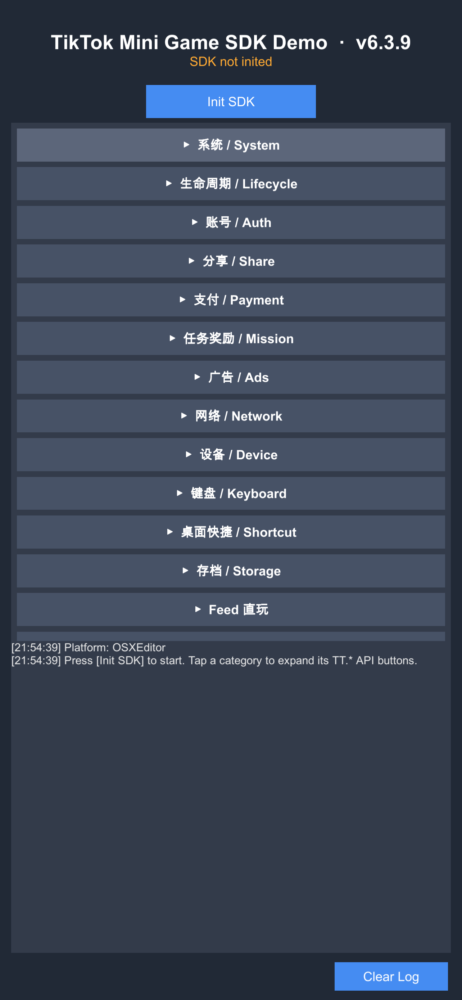
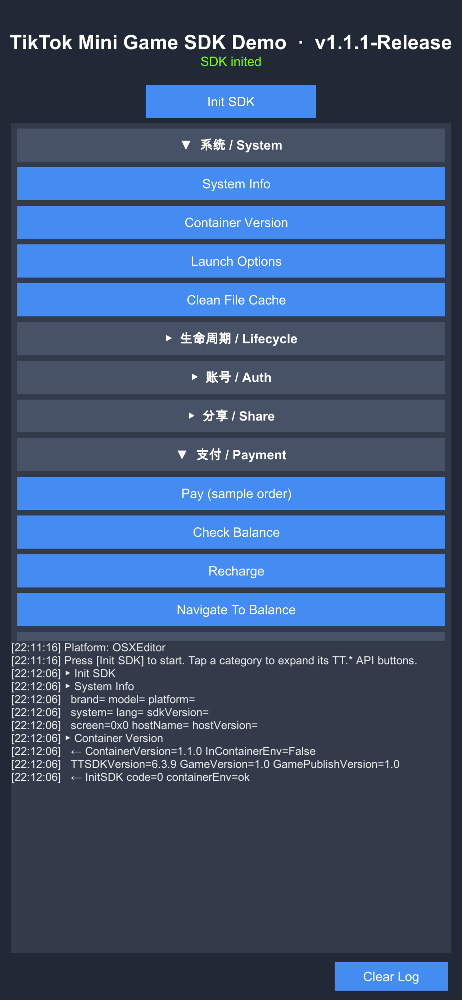

# TikTok 小游戏 · Unity SDK Demo

[English](README.md) · **中文**

> ## 📦 SDK 下载
>
> **[⬇️ 下载 `com.tiktok.minigame@1.1.7-Beta.unitypackage`](./com.tiktok.minigame@1.1.7-Beta.unitypackage)** (1.4 MB)
>
> 完整的 TikTok 小游戏 SDK 已经以单个 Unity 包的形式放在本仓库根目录。
> 拖进任意 Unity 2022.3 工程即可使用，详细步骤见
> [在你自己的工程里集成 SDK](#在你自己的工程里集成-sdk)。

接入 **TikTok 小游戏 SDK（TTSDK v1.1.7-Beta）** 的 Unity 参考工程，按分类把每一个公开的 `TT.*` 接口
做成可点击的按钮，所有回调结果实时滚到日志面板里——既能在 Unity Editor 里跑通，也能在
TikTok / 抖音小游戏容器内真机调试。

| 折叠首页 | 初始化 + 调用几个接口后 |
| --- | --- |
|  |  |

---

## 仓库目录一览

| 路径 | 用途 |
| --- | --- |
| `com.tiktok.minigame@1.1.7-Beta.unitypackage` | 可直接导入的 SDK 包（TTSDK v1.1.7-Beta），拖进任意 Unity 2022.3 工程即可。 |
| `Assets/Plugins/com.tiktok.minigame/` | 本工程已导入的 SDK 副本。 |
| `Assets/Demo/Scripts/DemoMainMenu.cs` | 运行时菜单——可折叠分类、每个 `TT.*` 接口一个按钮、日志面板。 |
| `Assets/Demo/Editor/DemoSceneBuilder.cs` | 用代码重建 `MainMenu.unity`（菜单：**TikTok Demo → Rebuild MainMenu Scene**）。 |
| `Assets/Demo/Editor/DemoSetup.cs` | 一键完成 PlayerSettings + 场景 + 切到 WebGL（菜单：**TikTok Demo → Run Full Setup**）。 |
| `Assets/Demo/Scenes/MainMenu.unity` | 入口场景（同时是 Build Settings 中的 0 号场景）。 |

---

## 环境要求

- Unity **2022.3.62f3**（2022.3.x LTS 任一小版本都行）。**不要**使用团结引擎（Tuanjie）
  分支——SDK 的 `asmdef` 会冲突。
- TTSDK **1.1.7-Beta**（或 ≥ 1.1.1）。自 v1.1.1 起额外提供 `ttsdk-editor.dll`，在 Unity Editor
  内能直接走 Mock 实现，不会再抛"不支持的平台"。
- Build target：WebGL（IL2CPP）。容器只支持 WebGL。

---

## 快速上手

```bash
git clone https://github.com/AnranS/tiktok-minigame-unity-demo.git
cd tiktok-minigame-unity-demo
# 用 Unity Hub → Add project → 选 2022.3.62f3（或任一 2022.3 LTS）打开
```

进入 Unity 之后：

1. 等首次资源导入完成。
2. 打开 `Assets/Demo/Scenes/MainMenu.unity`（这是默认场景，直接 Play 也行）。
3. 点 **Init SDK**，状态会变成绿色的 `SDK inited`。
4. 点任一分类头（▶）展开，再点任一子按钮就会调用对应的 `TT.*` 接口，结果实时滚到
   底部日志面板。

UI 改坏了随时可以用菜单 **TikTok Demo → Rebuild MainMenu Scene** 一键重建。

---

## 在你自己的工程里集成 SDK

直接从本仓库拿 SDK 包：

```
./com.tiktok.minigame@1.1.7-Beta.unitypackage
```

集成步骤：

1. 把 `.unitypackage` **拖进** Unity Project 窗口，或者走菜单
   **Assets → Import Package → Custom Package…** 选这个文件。
2. 导入对话框里全选（Import All）。
3. 导入后会得到：
   ```
   Assets/Plugins/com.tiktok.minigame/
     TTSDK/ttsdk.dll          ← runtime（仅 WebGL 加载）
     TTSDK/ttsdk-editor.dll   ← editor mock（仅 Editor 加载）
     Editor/ttsdk_tools.dll   ← 构建工具
     WebGL/                   ← 平台胶水代码
     LitJson/, DefaultTemplate/, link.xml, package.json
   ```
4. 配置 **Player Settings**：
   - Build target：**WebGL**
   - Scripting backend：**IL2CPP**（不支持 Mono）
   - Company / product name 随意——会出现在容器 UI 里
5. 确认 PluginImporter 的平台过滤（Unity 通常会根据 `.meta` 自动设好）：
   `ttsdk.dll` 只勾 WebGL，`ttsdk-editor.dll` 只勾 Editor。

接好之后 `using TTSDK;` 就能用了。

---

## 初始化 SDK

初始化是一个异步调用。所有依赖容器的接口（Login / Pay / Ads / Share / …）都必须等
这一步成功后才能正常工作。

```csharp
using TTSDK;
using UnityEngine;

public class Boot : MonoBehaviour
{
    void Start()
    {
        TT.InitSDK((code, env) =>
        {
            if (code == 0)
            {
                Debug.Log($"[TT] InitSDK ok, containerEnv={env?.GetType().Name}");
                // 现在可以安全调用 TT.Login / TT.Pay / TT.CreateRewardedVideoAd / …
            }
            else
            {
                Debug.LogError($"[TT] InitSDK failed, code={code}");
            }
        });
    }
}
```

Demo 中的等价实现在
[`DemoMainMenu.InitSdk()`](Assets/Demo/Scripts/DemoMainMenu.cs)。

### Editor 与 WebGL 的差异

| 运行环境 | 实际执行 | 说明 |
| --- | --- | --- |
| Unity Editor（Play 模式） | `TTAPIMock`，由 `ttsdk-editor.dll` 提供 | Mock 返回合理的默认值，方便快速迭代 UI / 接线逻辑，不必每次都 Build WebGL。可在 **模拟 / Mock (Editor)** 分类里按模块开关交互模拟弹窗。 |
| 开发者工具 / 线上 WebGL 包 | `TTAPIImpl`，由 `ttsdk.dll` 提供 | 与真实容器通信，登录 / 支付 / 广告等都是真实行为。 |

**Editor Mock 需要 SDK ≥ 1.1.1**。更早的版本只发了 WebGL target 编出来的 dll，在 Editor
里调用 `InitSDK` 会抛 `NotSupportedException: 不支持的平台`。

---

## API 参考

Demo 已覆盖 **v1.1.7-Beta** 中所有公开的 `TT.*` 接口，共 16 个运行时分类（另含 1 个仅 Editor
可见的 Mock 开关分类），按分类可折叠，下表对应 `MainMenu.unity` 中的按钮。

### 系统 / System

| 按钮 | 接口 | 说明 |
| --- | --- | --- |
| System Info | `TT.GetSystemInfo()` | 宿主 / 设备 / 语言 / 屏幕 / SDK 与宿主版本。 |
| Container Version | `TT.GetContainerVersion()`、`TT.InContainerEnv`、`TT.TTSDKVersion`、`TT.GameVersion`、`TT.GamePublishVersion` | 各类版本常量，用来做兼容判断。 |
| Launch Options | `TT.GetLaunchOptionsSync()` | 宿主启动时传入的 scene / path / query。 |
| Clean File Cache | `TT.CleanAllFileCache(cb)` | 清空 SDK 管理的缓存目录。 |

### 生命周期 / Lifecycle

| 按钮 | 接口 | 说明 |
| --- | --- | --- |
| Get App Lifecycle | `TT.GetAppLifeCycle()` | 获取应用生命周期管理器实例。 |
| Register App Show/Hide | `TT.GetAppLifeCycle().OnShow / OnHide` | 前/后台切换事件。 |
| Set Before-Exit Listener | `TT.SetOnBeforeExitAppListener(...)` | 拦截退出操作（配合 `CanIUse.SetOnBeforeExitAppListener` 判断支持性）。返回 `true` 自行处理退出，返回 `false` 走容器默认退出。 |

### 账号 / Auth

| 按钮 | 接口 | 说明 |
| --- | --- | --- |
| Login | `TT.Login(onSuccess, onFail)` | 用容器会话换一次性 `code`，由后端拿去开放接口换 openid。 |
| Authorize (user.info.basic) | `TT.Authorize("user.info.basic", onOk, onFail)` | 请求授权某个 scope。 |
| Request Subscribe Message (default / manual) | `TT.RequestSubscribeMessage(TTRequestSubscribeMessageParam)` | 请求用户确认订阅消息（支持默认与 `isManualSubscribe = true` 手动触发），返回 `isSubscribeConfirmed`（`accept` / `reject`）。 |

### 分享 / Share

| 按钮 | 接口 | 说明 |
| --- | --- | --- |
| Share App Message | `TT.ShareAppMessage(ShareAppMessageParam)` | 拉起容器分享面板。`Path` / `Query` 用于深链回游戏内某页。 |

### 支付 / Payment

| 按钮 | 接口 | 说明 |
| --- | --- | --- |
| Pay | `TT.Pay(TTPayParam)` | 用后端下发的 `trade_order_id` 发起支付。 |
| Check Balance | `TT.CheckBalance(TTCheckBalanceParam)` | 查询虚拟币余额（如 `BEANS`）是否足够。 |
| Recharge | `TT.Recharge(TTRechargeParam)` | 拉起预设档位充值流程。 |
| Navigate To Balance | `TT.NavigateToBalance(TTNavigateToBalanceParam)` | 跳转到余额 / 钱包页面。 |

### 任务奖励 / Mission

| 按钮 | 接口 | 说明 |
| --- | --- | --- |
| Start Entrance Mission | `TT.StartEntranceMission(TTStartEntranceMissionParam)` | 发起入口渠道任务。 |
| Get Entrance Mission Reward | `TT.GetEntranceMissionReward(TTGetEntranceMissionRewardParam)` | 查询 / 领取入口任务奖励。 |
| Get Revisit Mission Reward | `TT.GetRevisitMissionReward(TTGetRevisitMissionRewardParam)` | 查询复访任务奖励资格与场景（`canReceiveReward`、`rewardScene`、`scene`），要求宿主 ≥ 46.0.0。 |
| Report Mission Reward Granted | `TT.ReportMissionRewardGranted(TTReportMissionRewardGrantedParam)` | 业务发奖确认后通知 TikTok 展示奖励到账反馈（本身不负责发奖），要求宿主 ≥ 46.0.0。 |

### 广告 / Ads

| 按钮 | 接口 | 说明 |
| --- | --- | --- |
| Rewarded Ad: Create & Load / Show / Destroy | `TT.CreateRewardedVideoAd(...)`、`Load()`、`IsLoaded()`、`OnLoad`、`Show()`、`OnClose(isEnded)`、`OnError`、`Destroy()` | 创建、预加载（`Load()`，宿主 ≥ 46.1.0）、查询就绪态（`IsLoaded()`）、展示与销毁激励视频广告。 |
| Interstitial Ad: Create & Load / Show / Destroy | `TT.CreateInterstitialAd(...)`、`Load()`、`IsLoaded()`、`OnLoad`、`Show()`、`OnClose`、`OnError`、`Destroy()` | 创建、预加载（`Load()`，宿主 ≥ 46.1.0）、展示与销毁插屏广告。 |

### 网络 / Network

| 按钮 | 接口 | 说明 |
| --- | --- | --- |
| Get Network Type | `TT.GetNetWorkType(GetNetworkTypeParam)` | 一次性查询当前网络类型。 |
| On / Off NetworkStatus Change | `TT.OnNetworkStatusChange(cb)` / `TT.OffNetworkStatusChange(cb)` | 网络连接断/开订阅。 |
| On / Off NetworkWeak Change | `TT.OnNetworkWeakChange(cb)` / `TT.OffNetworkWeakChange(cb)` | 弱网状态订阅，做卡顿检测用。 |

### 设备 / Device

| 按钮 | 接口 | 说明 |
| --- | --- | --- |
| Vibrate Short | `TT.VibrateShort(VibrateShortParam)` | 短震动（iOS 约 15ms / Android 约 30ms）。 |
| Vibrate Long | `TT.VibrateLong(VibrateLongParam)` | 约 400ms 长震动。 |
| Set FPS 30 / 60 | `TT.SetPreferredFramesPerSecond(fps)` | 向引擎 + 容器提示目标帧率。 |

### 键盘 / Keyboard

| 按钮 | 接口 | 说明 |
| --- | --- | --- |
| Show Keyboard | `TT.ShowKeyboard(...)`、`TT.OnKeyboardInput`、`TT.OnKeyboardConfirm`、`TT.OnKeyboardComplete` | 拉起软键盘（仅 WebGL）并监听输入 / 确认 / 收起事件。 |
| Hide Keyboard | `TT.HideKeyboard(onOk, onErr)` | 收起软键盘。 |

### 桌面快捷 / Shortcut

| 按钮 | 接口 | 说明 |
| --- | --- | --- |
| Add Shortcut | `TT.AddShortcut(cb)` | 请求用户把游戏添加到桌面。 |
| Get Shortcut Mission Reward | `TT.GetShortcutMissionReward(GetShortcutMissionRewardParam)` | 查询桌面快捷方式任务奖励资格（`CanReceiveReward`）。 |

### 存档 / Storage

| 按钮 | 接口 | 说明 |
| --- | --- | --- |
| PlayerPrefs ++counter | `TT.PlayerPrefs.GetInt/SetInt/Save()` | 跨平台 KV 存储，接口形态与 Unity 的 `PlayerPrefs` 一致。 |
| Save / Load / Delete `<DemoSaving>` | `TT.Save<T>(obj)`、`TT.LoadSaving<T>()`、`TT.DeleteSaving<T>()` | 类型化对象持久化——默认每个类型一个槽，可传 `saveName` 自定义多槽。 |
| Clear All Savings | `TT.ClearAllSavings()` | 清空所有存档槽。 |
| Saving Disk Size | `TT.GetSavingDiskSize()` | 所有存档占用磁盘字节数。 |

### 文件系统 / FileSystem

| 按钮 | 接口 | 说明 |
| --- | --- | --- |
| FS Roundtrip | `TT.GetFileSystemManager()`（`AccessSync`、`MkdirSync`、`WriteFileSync`、`ReadFileSync`、`UnlinkSync`） | 在 `TTFileSystemManager.USER_DATA_PATH` 下验证同步写入、存在检查、读回与删除闭环。 |

### Feed 直玩 / Feed

| 按钮 | 接口 | 说明 |
| --- | --- | --- |
| On / Off Feed Status Change | `TT.OnFeedStatusChange(cb)` / `TT.OffFeedStatusChange(cb)` | 即看即玩进入 / 离开订阅。 |
| Get Feed Manager | `TT.GetFeedManager()` | 获取缓存的 `TTFeedManager` 实例。 |
| Store / Get Feed Data | `fm.StoreFeedData(StoreFeedDataParam)`、`fm.GetFeedData(GetFeedDataParam)` | 存储 / 读取 Feed 业务数据。 |
| Check / Request Feed Subscribe | `fm.CheckFeedSubscribeStatus(...)`、`fm.RequestFeedSubscribe(...)` | 查询与请求 Feed 订阅状态。 |

### 上报 / Analytics

| 按钮 | 接口 | 说明 |
| --- | --- | --- |
| Report Event | `TT.ReportEvent(ReportEventParam)` | 自定义埋点，参数为任意 JSON。 |
| Report Scene | `TT.ReportScene(json, onOk, onFail, onComplete)` | 场景 / 阶段耗时上报（`sceneId`、`costTime`），用于漏斗分析，要求宿主 ≥ 45.2.0。 |

### 能力检测 / CanIUse

| 按钮 | 接口 | 说明 |
| --- | --- | --- |
| Dump all CanIUse flags | `CanIUse.*` | 反射输出当前宿主 / 编辑器支持的全部 `CanIUse` 静态能力开关。 |

### 模拟 / Mock（仅 Editor）

| 按钮 | 接口 | 说明 |
| --- | --- | --- |
| Open All / Close All / 各模块开关 | `MockSetting.OpenAllMockModule()`、`CloseAllMockModule()`、`SwithMockModule(...)`、`HasFlag(...)` | 在 Unity Editor Play 模式下开关各功能域的交互模拟弹窗（WebGL 构建自动剔除）。 |

---

## v1.1.7-Beta 主要更新（相较 v1.1.1）

- **WASM 分包启动链路优化**（更新内置 `unity-plugin` 运行时）：
  - Android：`sub.wasm` 改用宿主原生异步 Brotli 解压、新增本地持久缓存、首帧后实例化，以及低开销的启动缓存封签校验。
  - iOS：archive 与主 WASM/Data 并行准备、新增本地持久缓存并支持按偏移按需读取函数体、合并 trampoline 编译、首帧后热点批次后台预编译。
- **新增 / 更新公开 API**：
  - 复访任务奖励接口：`TT.GetRevisitMissionReward`、`TT.ReportMissionRewardGranted`。
  - 订阅消息接口：`TT.RequestSubscribeMessage(TTRequestSubscribeMessageParam)`。
  - 广告预加载接口：`TTRewardedVideoAd.Load()` / `OnLoad` / `IsLoaded()` 与 `TTInterstitialAd.Load()` / `OnLoad` / `IsLoaded()`。
  - 修正 `CanIUse` 映射：`SetOnBeforeExitAppListener`（`onBeforeExitMiniProgram`）与 `GetNetWorkType`（`getNetworkType`）。
- **SDK 稳定性与清理**：移除旧版不可达编辑器发布/构建代码，加固 WebGL 生命周期与存档格式兼容性，移除 `LaunchOption` 克隆对 `BinaryFormatter` 的依赖。

---

## 出包到 TikTok 小游戏

SDK 自带构建管线，会产出 WebGL 包 + 开发者工具需要的元数据文件。

1. 打开菜单 **Window → TTSDK → Build Tool**。
2. 填好 AppID、版本号等。
3. 点 **Build**——产物会落到 `./tt-minigame/webgl/`，同时自动生成包含 `sdkVersion` 字段的 `game.json`。
4. 把 `tt-minigame/` 上传到开发者后台（或通过 `@ttmg/cli` 本地预览）做预览 / 提审。

走 Unity 原生 File → Build Settings → WebGL 也能编出包，但不会产出 `tt-minigame/`
目录结构，容器不认。

---

## Editor 调试须知

- `TT.InitSDK` 在 Editor 里走 Mock（需 SDK ≥ 1.1.1）。绝大多数回调返回的是合理的演示
  默认值，**不**代表真机行为。
- 真机行为（震动、分享面板、支付、广告、真实 openid）必须 Build → WebGL，到开发者工具
  或线上容器去看。
- 如果 `Init SDK` 抛 `NotSupportedException: 不支持的平台`，多半是用了缺少
  `ttsdk-editor.dll` 的旧 SDK，重新导入本仓库根目录的 unitypackage 即可。

---

## 工程结构

```
.
├── com.tiktok.minigame@1.1.7-Beta.unitypackage      # SDK 包，可拖到其他工程
├── Assets/
│   ├── Demo/
│   │   ├── Editor/
│   │   │   ├── DemoSceneBuilder.cs                  # 代码驱动的场景重建与版本同步
│   │   │   └── DemoSetup.cs                         # 一键配置入口
│   │   ├── Scenes/MainMenu.unity                    # 入口场景（Build Settings 第 0 个）
│   │   └── Scripts/DemoMainMenu.cs                  # 运行时菜单 + 接口接线
│   └── Plugins/com.tiktok.minigame/                 # 已导入的 SDK（请勿修改）
├── docs/screenshots/                                # README 配图
├── Packages/manifest.json                           # Unity 包列表
├── ProjectSettings/                                 # Unity 工程设置
└── README.md / README.zh.md
```

---

## 常见问题排查

| 现象 | 可能原因 | 处理 |
| --- | --- | --- |
| Editor 里 `Init SDK` 抛 `NotSupportedException: 不支持的平台` | SDK 老于 1.1.1，没有 editor dll | 用本仓库根目录的 `com.tiktok.minigame@1.1.7-Beta.unitypackage` 重新导入。 |
| 按钮看不见，只有几个深色条 | 老的 `Mask + null sprite + alpha 0.001` viewport 写法在 Unity 2022.3+ 的 stencil 上有回归 bug | 跑菜单 **TikTok Demo → Rebuild MainMenu Scene**——Demo 已切到 `RectMask2D`，绕开了这个坑。 |
| WebGL build 在 IL2CPP / linker 阶段失败 | 裁剪误删了 SDK 用到的类型 | 保留 `Assets/Plugins/com.tiktok.minigame/link.xml` 不要动。 |
| Build 出来的 `game.json` 没有 `sdkVersion` 字段 | 用的是 Unity 原生 File → Build Settings | 改用 SDK 自带的 **Build Tool**（Window → TTSDK → Build Tool）。 |

---

## 许可

本 Demo 作为外部开发者参考工程对外发布。`Assets/Plugins/com.tiktok.minigame/` 下的 TTSDK
插件遵循其自身的许可协议——参见 SDK 的 `package.json` 与开放平台的相关协议。
